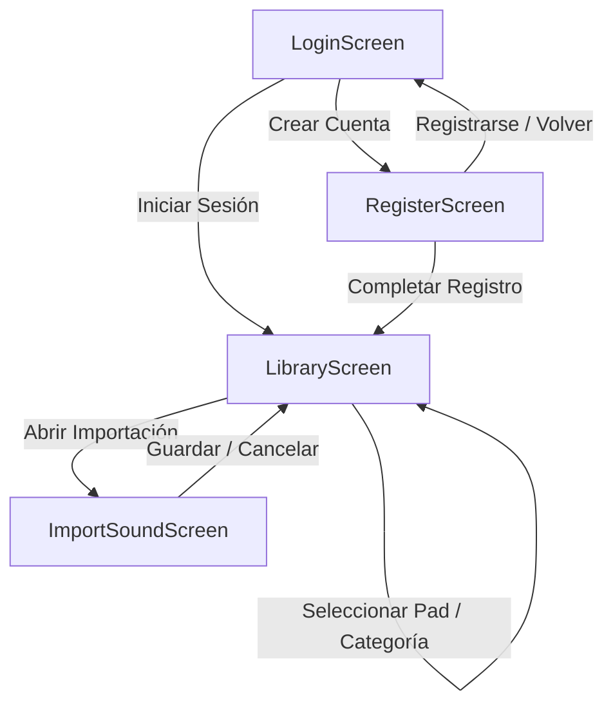
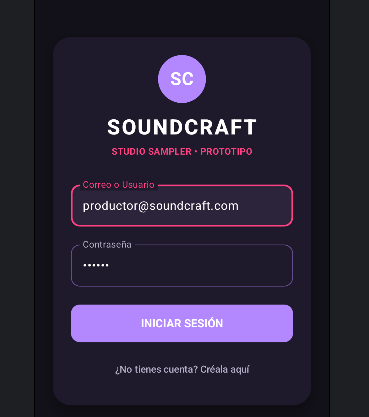
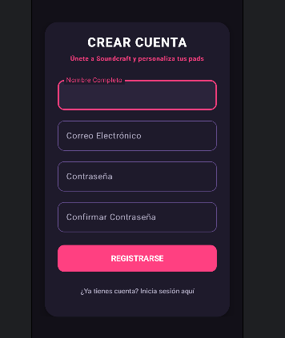
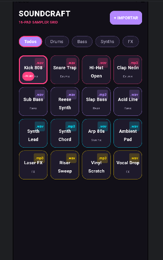
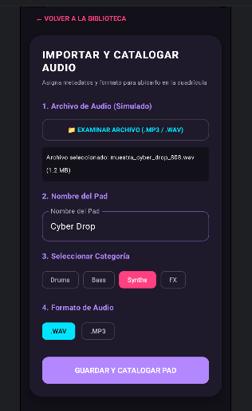

# Especificación de Requerimientos y Arquitectura de Prototipo - Soundcraft

## 1. Descripción General y Objetivo de la Aplicación

**Soundcraft** es una aplicación móvil Android diseñada para la exploración, organización y reproducción táctil de muestras de audio (samples y efectos de sonido). Su objetivo principal es ofrecer una interfaz intuitiva, moderna y dinámica orientada a músicos, productores de audio y entusiastas de la creación sonora.

En esta fase de **prototipo visual**, la aplicación se centra en validar la experiencia de usuario (UX/UI), facilitando la navegación fluida entre pantallas, la simulación táctil de pads de sonido organizados en una matriz 4x4, el filtrado por categorías, la representación visual del reproductor de audio y la simulación del proceso de importación y catalogación de archivos `.mp3` y `.wav`.

---

## 2. Requerimientos Funcionales y No Funcionales

### 2.1 Requerimientos Funcionales (RF)
* **RF-01 (Autenticación Prototipo - Login):** Formulario visual de inicio de sesión con campos para usuario/correo y contraseña, botón de acción e hipervínculo para navegar al registro.
* **RF-02 (Autenticación Prototipo - Registro):** Formulario visual de creación de cuenta con campos para nombre, correo y contraseña, con botón de registro que redirige al flujo principal.
* **RF-03 (Matriz de 16 Pads 4x4):** Cuadrícula interactiva de 16 pads con estados visuales (presionado, inactivo, activo/seleccionado) e información sintética de sonido.
* **RF-04 (Selector de Categorías):** Barra o lista de filtros para categorizar los sonidos (ej. *Drums*, *Bass*, *Synths*, *FX*, *Vocals*).
* **RF-05 (Reproductor de Audio Visual):** Barra o módulo inferior (Mini Player / Panel de detalle) que simula el control de reproducción (Play/Pause, barra de progreso/waveform ficticia y nombre del track actual).
* **RF-06 (Importación y Catalogación Visual):** Pantalla o diálogo para simular el proceso de agregar y etiquetar archivos en formato `.mp3` y `.wav`.
* **RF-07 (Navegación entre Pantallas):** Flujo de navegación interactivo entre Login, Register, Biblioteca de Pads e Importación/Catalogación.

### 2.2 Requerimientos No Funcionales (RNF)
* **RNF-01 (Interfaz y Tema Oscuro Obligatorio):** Diseño gráfico fundamentado exclusivamente en tema oscuro (Dark Theme) con paleta basada en tonos oscuros, violetas y rosados neón.
* **RNF-02 (Alto Contraste y Accesibilidad):** Elementos visuales y textos con alto contraste para asegurar legibilidad en entornos oscuros o escenarios en vivo.
* **RNF-03 (Botones Táctiles Amplios):** Target táctil amplio en los pads de sonido y botones de acción para prevenir toques accidentales.
* **RNF-04 (Rendimiento de Interfaz):** Renderizado fluido a 60 fps mediante Jetpack Compose en layouts reactivos.
* **RNF-05 (Consistencia de Diseño):** Aplicación estricta de lineamientos de Material Design 3.

---

## 3. Descripción del Funcionamiento de cada Pantalla

### 3.1 Pantalla de Login
* **Propósito:** Simular el acceso de usuario.
* **Elementos Visuales:** Logo de Soundcraft, campo de texto para correo/usuario, campo de texto para contraseña (oculto), botón prominente "Iniciar Sesión" y enlace "Crear Cuenta".
* **Comportamiento:** El toque en "Iniciar Sesión" simula una autenticación exitosa y navega a la Biblioteca Principal. El enlace redirige a la pantalla de Registro.

### 3.2 Pantalla de Register
* **Propósito:** Simular el registro de un nuevo usuario.
* **Elementos Visuales:** Título de registro, campos de texto (Nombre completo, Correo electrónico, Contraseña y Confirmar contraseña), botón "Registrarse" y enlace para volver al Login.
* **Comportamiento:** Al pulsar "Registrarse", se navega hacia la Biblioteca Principal.

### 3.3 Biblioteca Principal con 16 Pads (Cuadrícula 4x4)
* **Propósito:** Centro de interacción táctil con los sonidos catalogados.
* **Elementos Visuales:** Matriz de 4 filas x 4 columnas (16 botones/pads). Cada pad cuenta con un color distintivo según la categoría, etiqueta del nombre del sonido y un indicador visual de estado.
* **Comportamiento:** Al pulsar un pad, este cambia de estado visual (efecto de pulsación/brillo rosado/violeta) y actualiza el Reproductor de Audio inferior mostrando el nombre del sonido seleccionado.

### 3.4 Selector de Categorías
* **Propósito:** Filtrar los 16 pads de la cuadrícula según la familia sonora.
* **Elementos Visuales:** Chips o pestañas horizontales scrolleables (*Todos*, *Drums*, *Bass*, *Synths*, *FX*, *Percussion*).
* **Comportamiento:** Al presionar una categoría, la interfaz actualiza visualmente los nombres o colores de los pads representados.

### 3.5 Reproductor de Audio
* **Propósito:** Mostrar el estado de reproducción del audio seleccionado.
* **Elementos Visuales:** Barra inferior estática o colapsable que incluye título de la muestra, etiqueta del formato (`.mp3` / `.wav`), botón Play/Pause y una barra de progreso simulación.
* **Comportamiento:** Permite alternar visualmente entre los estados *Playing* y *Paused*.

### 3.6 Importación y Catalogación de Archivos (.mp3 y .wav)
* **Propósito:** Simular la incorporación de nuevos sonidos al sistema.
* **Elementos Visuales:** Formulario de importación con selector ficticio de archivo, campo para asignar nombre del pad, selector desplegable de categoría y asignación del formato (`.mp3` o `.wav`).
* **Comportamiento:** Al confirmar la importación, el prototipo simula el guardado y retorna a la biblioteca principal mostrando un mensaje flotante (Snackbar/Toast prototipado).

---

## 4. Dominios Principales de la Aplicación y Responsabilidades

1. **Dominio de Autenticación (Auth Domain):**
   * Responsabilidad: Gestión del estado visual de sesión (login, registro y sesión simulada).
2. **Dominio de Sonidos y Catalogación (Sound Catalog Domain):**
   * Responsabilidad: Estructuración de datos mock de los samples de audio, asignación de nombres, categorías, formatos (`.mp3`/`.wav`) y posicionamiento en la cuadrícula 4x4.
3. **Dominio de Reproducción (Player Domain):**
   * Responsabilidad: Gestión del estado de reproducción del prototipo (track activo, estado Play/Pause, progreso ficticio).
4. **Dominio de Importación (Import Domain):**
   * Responsabilidad: Control del formulario visual de carga y asignación de metadatos a nuevos pads ficticios.

---

## 5. Arquitectura Propuesta dentro de Android Studio

La estructura de paquetes se organiza según principios de arquitectura limpia orientada a características (*Feature-based / Layered package structure*):

```text
com.example.soundcraftseminario/
├── MainActivity.kt                       # Punto de entrada de la app
├── ui/
│   ├── theme/                            # Configuración de Material 3 y tema oscuro
│   │   ├── Color.kt                      # Paleta de violetas, rosados y oscuros
│   │   ├── Theme.kt                      # SoundcraftTheme (Dark theme forzado)
│   │   └── Type.kt                       # Tipografía personalizada
│   ├── components/                       # Componentes reutilizables de UI
│   │   ├── SoundPad.kt                   # Botón/Pad individual de sonido (4x4)
│   │   ├── CategoryChip.kt               # Chip de filtro por categoría
│   │   ├── AudioPlayerBar.kt             # Barra reproductora de audio
│   │   └── SoundcraftTextField.kt        # Campo de texto personalizado
│   ├── screens/                          # Pantallas de la aplicación
│   │   ├── login/
│   │   │   └── LoginScreen.kt            # Pantalla de inicio de sesión
│   │   ├── register/
│   │   │   └── RegisterScreen.kt         # Pantalla de registro
│   │   ├── library/
│   │   │   └── LibraryScreen.kt          # Pantalla principal con rejilla 4x4 y categorías
│   │   └── importsound/
│   │       └── ImportSoundScreen.kt      # Pantalla/formulario de importación de audio
│   └── navigation/
│       └── AppNavigation.kt              # Estructura de navegación y estados de pantalla
└── data/
    └── mock/
        └── MockSoundData.kt              # Proveedor de datos de sonido de ejemplo
```

---

## 6. Tecnologías Utilizadas

* **Lenguaje:** Kotlin 2.2.10
* **Framework UI:** Jetpack Compose (Compose BOM 2026.02.01)
* **Sistema de Diseño:** Material Design 3 (`androidx.compose.material3`)
* **Navegación:** Control de estados de pantalla en Compose (`rememberSaveable` / estado reactivo de navegación).
* **SDK objetivo:** Android 14+ (API Level 37 target, minSdk 24).

---

## 7. Lineamientos de Diseño

* **Tema Oscuro Obligatorio:** Fondo principal en tonos gris oscuro/negro profundo (`#121212` / `#1E1B2E`) para minimizar la fatiga visual.
* **Paleta de Colores Neón:**
  * Primario: Violeta Neón (`#BB86FC` / `#9C27B0`)
  * Secundario/Acento: Rosado Eléctrico (`#FF4081` / `#F50057`)
  * Superficies: Tonos de violeta/gris oscuro con elevación visual (`#2D283E`)
  * Texto y Contraste: Blanco puro (`#FFFFFF`) y Magenta/Rosa para resaltar acciones activas.
* **Ergonomía Táctil:**
  * Pads con bordes redondeados y target mínimo de touch amplio para facilitar la ejecución rápida.
  * Feedback táctil/visual inmediato en estado `pressed`.
* **Estética:** Estilo ciberpunk / synthwave moderno, profesional y legible.

---

## 8. Navegación y Relación entre las Pantallas



* **Flujo 1:** Inicio en `LoginScreen` $\rightarrow$ Transición a `RegisterScreen` o ingreso directo a `LibraryScreen`.
* **Flujo 2:** En `LibraryScreen`, interacción con la rejilla 4x4, selector de categorías y reproductor visual en la parte inferior.
* **Flujo 3:** Transición desde `LibraryScreen` hacia `ImportSoundScreen` para simular la adición de archivos `.mp3` / `.wav`.

---

## 9. Componentes Principales de Jetpack Compose Utilizados

* `Scaffold`: Estructura base de pantalla para organizar barras superiores, contenido principal y reproductor inferior.
* `LazyVerticalGrid` (o `Column` + `Row` de 4x4): Para construir la matriz de 16 pads de forma simétrica y responsiva.
* `Card` / `Surface`: Para encapsular cada pad de sonido con elevación, bordes y colores dinámicos.
* `FilterChip` / `LazyRow`: Para la barra horizontal del selector de categorías.
* `OutlinedTextField`: Para los campos de formulario en Login, Register e Importación.
* `Button` / `ElevatedButton`: Para las acciones principales con estilo personalizado en violeta y rosado.
* `LinearProgressIndicator` / `Slider`: Para representar la barra de reproducción de audio.
* `Icon` & `IconButton`: Iconografía estándar de Material Icons (Play, Pause, Add, ArrowBack, Sound, etc.).


## 10. Mockups de la aplicación

A continuación, se presentan los diseños de las principales pantallas de SoundCraft, realizados durante la etapa de diseño de la interfaz. Los mockups representan la propuesta visual de la aplicación y establecen los lineamientos que se utilizaron posteriormente para desarrollar el prototipo en Android Studio.

### 10.1. Pantalla de Login



### 10.2. Pantalla de Registro



### 10.3. Pantalla de Librería



### 10.4. Pantalla de Importación

